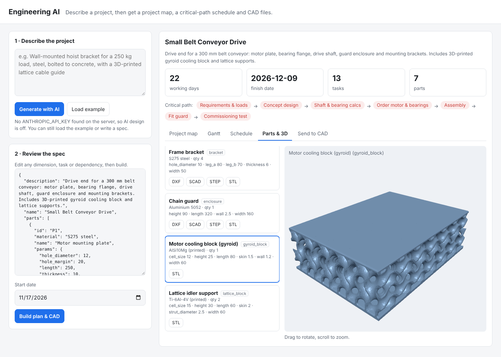

# Engineering AI

Turns an engineering brief into a **project map** (dependency graph, critical-path schedule, Gantt chart)
and **CAD files** for every part, ready to import into your CAD tool or upload straight to Onshape.

```
brief ──(Claude)──► project spec (JSON) ──► CPM planner ──► project map, Gantt, schedule
                                      ├──► parametric CAD ──► .step .stl .dxf .scad
                                      ├──► lattice / gyroid parts (implicit, 3D-printable) ──► .stl
                                      ├──► PicoGK C# project (LEAP 71 kernel behind Noyron)
                                      └──► CAD connectors: Fusion 360, FreeCAD, SolidWorks, Onshape
```



## Web interface

```bash
python -m engineering_ai web
```

Then open http://127.0.0.1:8000. You can:

1. Type a brief and click **Generate with AI**, or click **Load example**.
2. Edit the spec if you want, then click **Build plan & CAD**.
3. Look at the project map, Gantt chart, schedule table and an interactive 3D view of each part.
4. Use **Send to CAD** to download packages for Fusion 360, FreeCAD, SolidWorks or PicoGK, or upload to Onshape.

## Install

```bash
pip install -r requirements.txt
pip install cadquery          # optional, for 3D STEP/STL export
```

## Command line

From a plain-English brief (needs an Anthropic API key in `ANTHROPIC_API_KEY`):

```bash
python -m engineering_ai design "Design a wall-mounted hoist bracket for a 250 kg load, steel, bolted to concrete" -o out/
```

From a spec you wrote or edited yourself (no API key needed):

```bash
python -m engineering_ai build examples/conveyor.json -o out/
```

Upload a part to an Onshape document. You need API keys from dev-portal.onshape.com, set as `ONSHAPE_ACCESS_KEY` and `ONSHAPE_SECRET_KEY`:

```bash
python -m engineering_ai upload out/parts/P1.step --document <doc id> --workspace <workspace id>
```

The document and workspace IDs are in the Onshape URL: `cad.onshape.com/documents/<doc id>/w/<workspace id>/...`.

## Output

| File | What it is |
|---|---|
| `out/report.md` | CPM table (ES/EF/LS/LF/slack), critical path, Mermaid dependency map and Gantt, parts list |
| `out/project.json` | The spec. Edit the dimensions or tasks here and re-run `build` |
| `out/parts/*.step` | 3D solids for SolidWorks, Fusion 360, Inventor, FreeCAD and Onshape |
| `out/parts/*.stl` | Meshes for 3D printing and viewers |
| `out/parts/*.dxf` | 2D drawings with dimensions for AutoCAD, laser cutting and CNC |
| `out/parts/*.scad` | Editable parametric OpenSCAD source |
| `out/connectors/` | Import scripts for Fusion 360, FreeCAD and SolidWorks (see below) |
| `out/picogk/` | PicoGK C# program that rebuilds every part in LEAP 71's voxel kernel |

## Sending to CAD programs

| Program | How |
|---|---|
| Fusion 360 | Utilities › Scripts and Add-Ins › **+** › pick `out/connectors/fusion360/EngineeringAIImport` › Run. Imports every STEP part into one design. |
| FreeCAD | Macro › Macros… › `out/connectors/freecad/ImportProject.FCMacro` › Execute. Imports STEP and STL parts and saves an `.FCStd`. |
| SolidWorks | Tools › Macro › Run › `out/connectors/solidworks/ImportParts.swb`. Converts each STEP part to `.SLDPRT`. |
| Onshape | Direct upload over the REST API (`upload` command or the web interface). |
| Others (AutoCAD, NX, Inventor, Creo…) | Open the STEP (3D) or DXF (2D) files in `out/parts`. |

The scripts find the parts relative to their own location, so you can zip the `out/` folder and move it to another computer.

## PicoGK / Noyron-style computational parts

[Noyron](https://leap71.com) is LEAP 71's proprietary AI engineering model, and there is no public access to it.
It runs on the open-source geometry kernel [PicoGK](https://github.com/leap71/PicoGK) (Apache 2.0), which this tool targets directly:

- **`gyroid_block`**: a gyroid (triply-periodic minimal surface) core between solid plates. It's light, stiff and open to flow, which suits heat exchangers and cooling blocks.
- **`lattice_block`**: a body-centred-cubic strut lattice between plates, for lightweight supports.

These parts are defined as signed-distance fields. Python meshes them with marching cubes so they work anywhere. The same fields are also written as C# `IImplicit` classes in `out/picogk/Program.cs`, so PicoGK can rebuild them at full voxel resolution and voxelise the standard parts alongside them.

To run the PicoGK project you need the .NET 9 SDK on **Windows x64 or an Apple-silicon Mac** (the PicoGK runtime ships only for those platforms):

```bash
cd out/picogk
dotnet run
```

The PicoGK viewer opens and STL files are written to `out/picogk/output/`.

## Algorithms

- **Kahn's topological sort** orders tasks and rejects dependency cycles.
- **Critical Path Method**: the forward pass gives the earliest start and finish of each task, the backward pass gives the latest. Slack is LS − ES, and tasks with zero slack form the critical path.
- **Parametric solid modelling** (CadQuery/OpenCascade): each part type is a function from its dimensions to a solid. Parameter checks run first, so impossible geometry is rejected (for example, bolt holes outside a flange).

## Part library

Standard (B-rep, STEP + DXF): `plate`, `bracket` (L-angle), `shaft` (optionally stepped), `flange` (bolt circle), `enclosure` (open-top box).
Computational (implicit, STL + PicoGK): `gyroid_block`, `lattice_block`.
Defaults and parameter names are in `engineering_ai/cad.py` (`DEFAULTS`). To add a type, add it to
`DEFAULTS` and write its `write_dxf`, `write_scad` and `build_solid` branches.

## Limits

The Fusion 360, SolidWorks and PicoGK outputs are generated from those programs' documented APIs, but they haven't been run inside those programs yet. The FreeCAD and Fusion scripts are syntax-checked.

The AI picks dimensions that look reasonable, but it does not run stress analysis.
Have a qualified engineer check loads, safety factors and standards before anything is manufactured.

## Tests

```bash
python -m pytest -q
```
